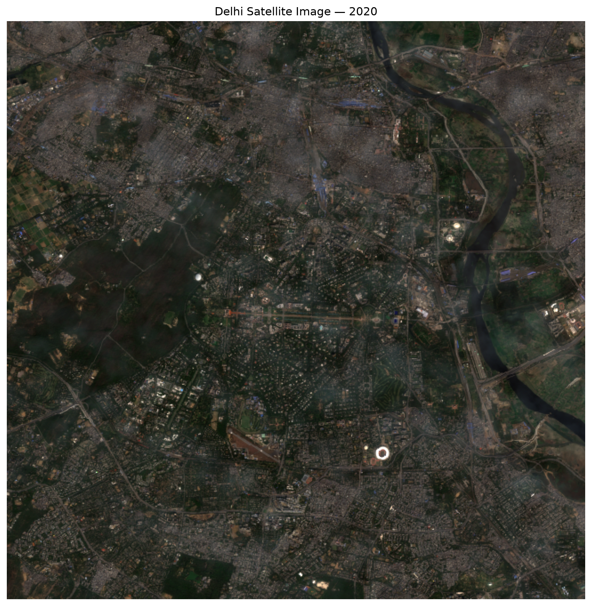
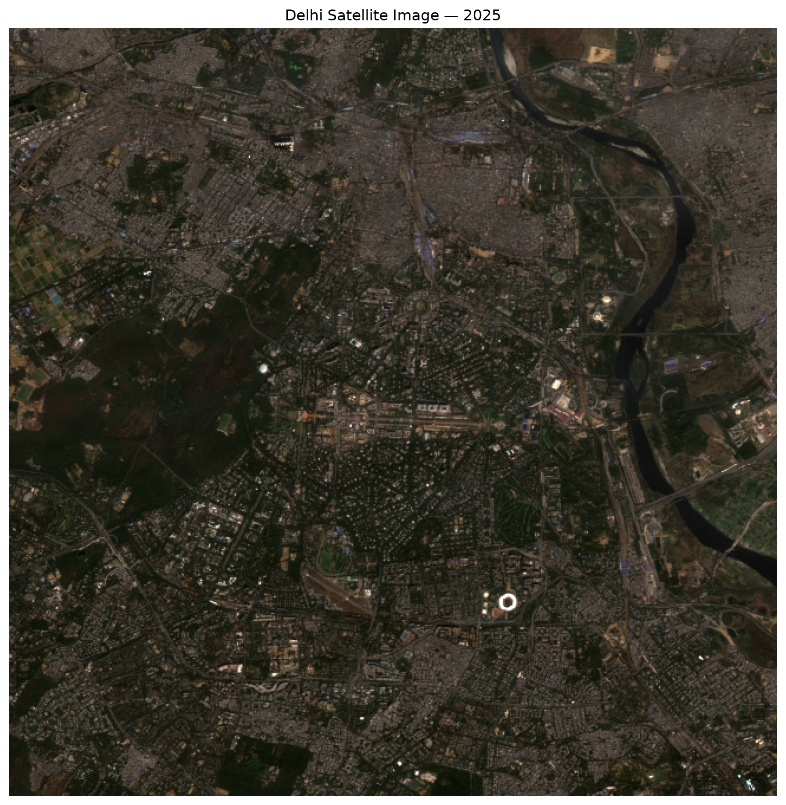
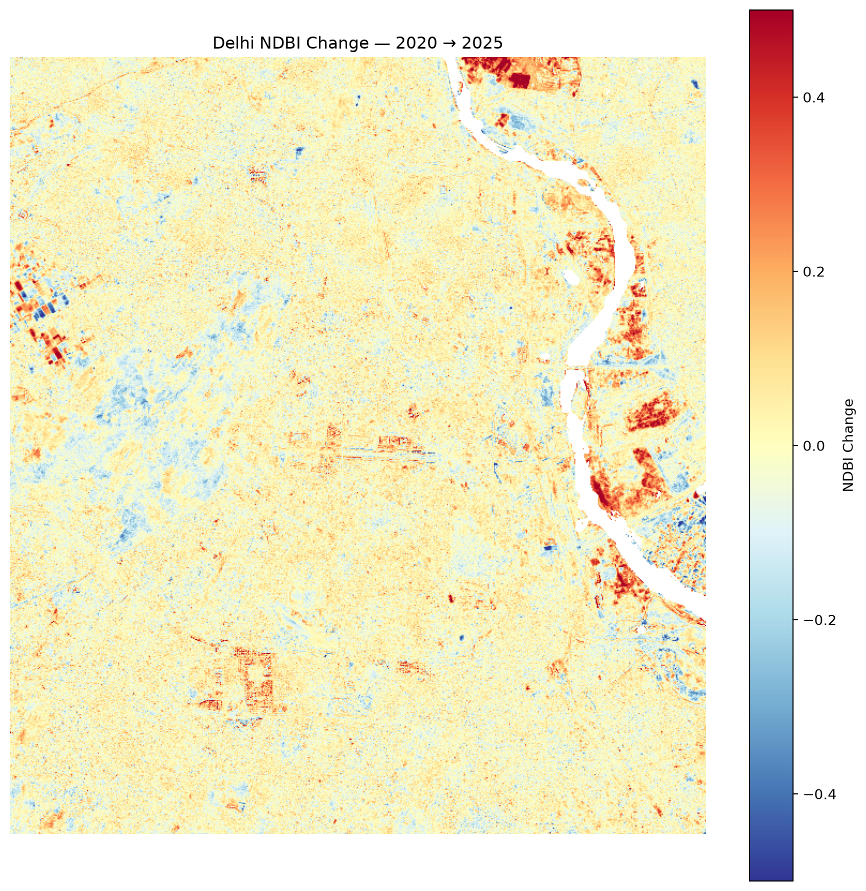

# Tarang | Satellite Imagery Change Analysis

**Exploring landscape change through multi-temporal satellite imagery.**

Tarang is an interactive geospatial analysis prototype built with Python and Streamlit. It retrieves Sentinel-2 satellite imagery and uses spectral indices to explore changes in vegetation and built-up signals across locations and time periods.

> Project focus: Earth observation · Remote sensing · Geospatial data analysis · Environmental monitoring

## Project Preview

Tarang supports comparison of satellite imagery from different time periods and visualization of potential landscape changes.

### Satellite Imagery Comparison

| Delhi — 2020 | Delhi — 2025 |
|---|---|
|  |  |

### Change Detection Visualization



*Visualizations are exploratory outputs from the current prototype, not independently validated land-cover classifications.*

## Why Tarang?

Urban expansion and changes in vegetation can affect infrastructure planning, environmental management, and sustainable development. Satellite imagery provides a way to examine these patterns over time.

Tarang brings satellite data retrieval, spectral analysis, image processing, and interactive visualization into a single workflow.

## Key Features

- **Satellite imagery retrieval:** Access Sentinel-2 Level-2A imagery through Sentinel Hub.
- **Multi-temporal comparison:** Examine imagery from different dates or years.
- **Vegetation analysis:** Use the Normalized Difference Vegetation Index (NDVI).
- **Built-up signal analysis:** Use the Normalized Difference Built-up Index (NDBI).
- **Change visualization:** Generate maps highlighting potential changes.
- **Interactive exploration:** Use a Streamlit interface to interact with the analysis.
- **Location-oriented queries:** Parse supported natural-language location queries.

## How It Works

1. Select or query a study location.
2. Define the area and time periods for analysis.
3. Retrieve satellite imagery through Sentinel Hub.
4. Process imagery and calculate relevant spectral indices.
5. Compare index patterns and visualize potential changes.
6. Explore the resulting maps through the application.

## Technology Stack

| Technology | Purpose |
|---|---|
| Python | Core application and analysis |
| Streamlit | Interactive application interface |
| Sentinel Hub | Satellite imagery access |
| NumPy | Numerical and array operations |
| SciPy | Image-processing operations |
| Pillow | Image handling |
| Requests | HTTP requests |
| python-dotenv | Local environment configuration |

## Getting Started

### Prerequisites

- Python 3.10 or another Python version compatible with the project's dependencies
- A Sentinel Hub account with suitable data access
- Sentinel Hub credentials configured for the application

### 1. Clone the repository

```bash
git clone https://github.com/25-ritika/tarang-satellite-change-analysis.git
cd tarang-satellite-change-analysis
```

### 2. Create a virtual environment

**Windows:**

```bash
python -m venv .venv
.venv\Scripts\activate
```

### 3. Install dependencies

```bash
python -m pip install -r requirements.txt
```

### 4. Configure credentials

Create a local `.env` file containing the Sentinel Hub credential variables expected by the application.

For example, if the application reads these variable names:

```env
SH_CLIENT_ID=your_client_id
SH_CLIENT_SECRET=your_client_secret
```

Ensure the variable names match the code. Never commit `.env`, access tokens, or secrets to GitHub.

### 5. Launch the application

```bash
streamlit run app.py
```

## Understanding the Indices

**Normalized Difference Vegetation Index (NDVI)**

NDVI uses near-infrared and red reflectance to help examine vegetation patterns.

**Normalized Difference Built-up Index (NDBI)**

NDBI uses shortwave-infrared and near-infrared reflectance to help highlight built-up signals.

Neither index alone proves that an area has undergone urban development. Results must be interpreted alongside imagery quality, seasonal differences, and other evidence.

## Limitations

- Cloud cover, shadows, haze, and atmospheric conditions can affect imagery.
- Seasonal and acquisition differences can influence spectral indices.
- Threshold-based change maps may include false positives.
- Results have not been established as ground-truth-validated measurements.
- The current prototype uses numerical analysis and image-processing methods; it does not require a separately trained machine-learning model.

## Roadmap

- [ ] Improve cloud and cloud-shadow masking.
- [ ] Improve consistency between images from different dates.
- [ ] Add quantitative evaluation using reference data.
- [ ] Improve geospatial map visualization.
- [ ] Add automated analysis reports.
- [ ] Expand location and date selection options.
- [ ] Add automated tests for the processing pipeline.

## Contributing

Contributions and suggestions are welcome.

1. Fork the repository.
2. Create a branch for your change.
3. Test your changes locally.
4. Submit a pull request describing your contribution.

For substantial changes, open an issue first to discuss the proposed approach.

## License

Distributed under the MIT License. See the `LICENSE` file for details.

## Acknowledgements

- [Copernicus Data Space Ecosystem](https://dataspace.copernicus.eu/)
- [Sentinel Hub](https://www.sentinel-hub.com/)
- [Streamlit](https://streamlit.io/)

---

**Tarang — Exploring landscape change through satellite imagery.**
